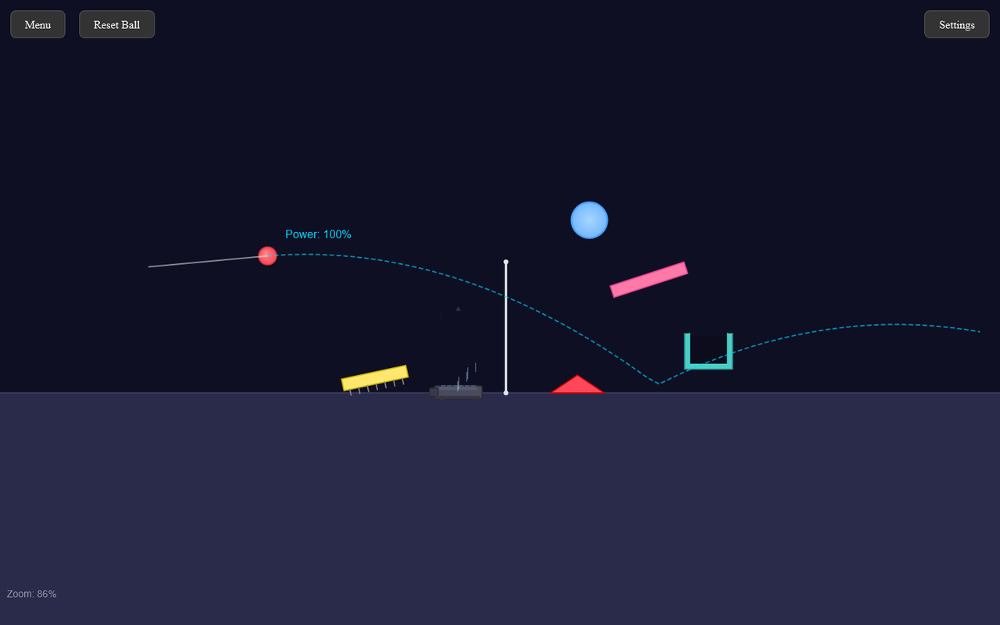
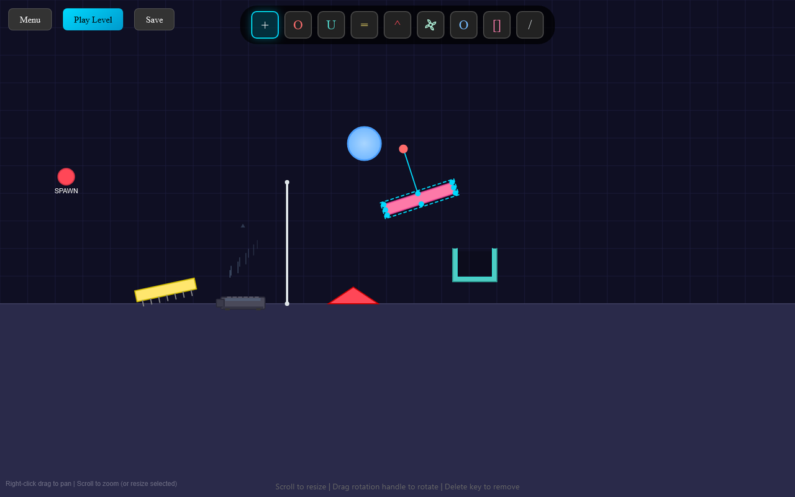
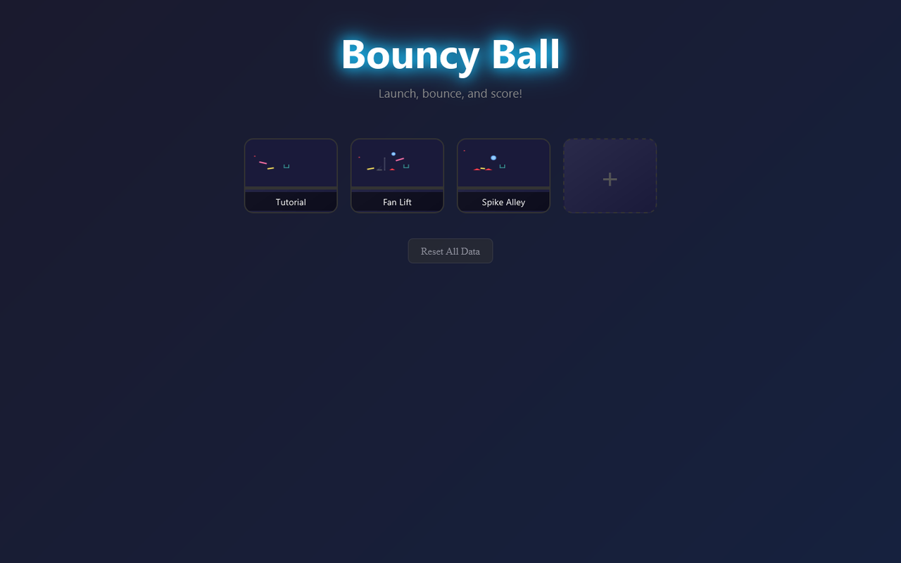

# Bouncy Ball
A launch-and-bounce physics puzzle: pull back on the ball, let it fly, and bounce it off trampolines, shapes and fans until it lands in the cup. Comes with a level editor for building your own.

**[▶ Open the live app](https://timothyhadfield.github.io/bouncy-ball/)** · best on a laptop (aiming and the editor use a mouse)

  
  &nbsp;
  

  

## Features
- **Slingshot launch**: drag back from the ball to aim; a dotted line previews the arc and shows your power.
- **Physics pieces**: trampolines, fans that blow the ball upward, spikes that pop it, circles, blocks and walls.
- **Level editor**: place pieces from a toolbar, drag to move, scroll to resize, drag a handle to rotate, and set the ball's start point.
- **Per-level physics**: gravity, bounciness and friction sliders for each level.
- **Your levels are saved**: the menu shows a thumbnail of every level, and everything is kept in your browser.
- **Camera**: the view frames the ball and the cup, zooms out as you pull back, and can be panned (right-drag) and zoomed (scroll).

## Built with
One HTML file: plain JavaScript and Canvas, with a hand-written physics loop. No build step, no server.
